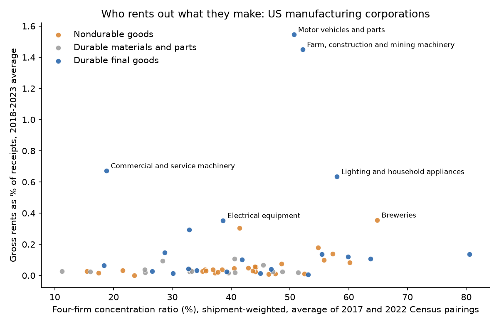
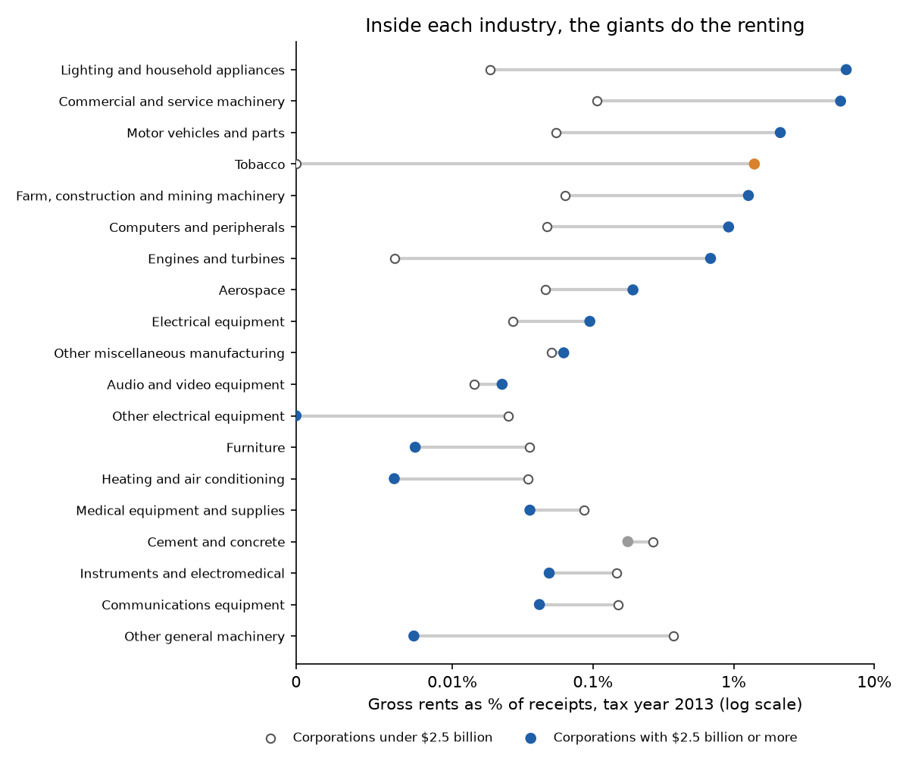

# Rent or Sell

### In 1982, Jeremy Bulow asked why a company that makes something durable would rather rent it out than sell it. Using the tax returns of every American manufacturer, I asked again.

---

In tax year 2023, the corporations that make cars, trucks and their parts in the United States took in $1.14
trillion selling what they built. They took in another $17.2 billion renting it out. The carmakers' own finance companies,
Ford Credit and GM Financial among them, are in the business of leasing new cars to drivers and taking them back a
few years later. Farm and construction machinery
makers, the industry of Deere and Caterpillar, reported $1.86 billion of rents on $179 billion of sales. Pitney Bowes leases postage meters to American offices,
and the federal postal regulations describe a meter distributor as a firm that leases meters to the customers who
use them.

Renting out a product instead of selling it looks like an odd choice for a manufacturer. The company has to finance
the machine, track it, repair it and sell it again when it comes back. Economists have a reason for it that has
nothing to do with customer service. A company with market power over something that lasts is in competition with
its own future sales, and renting is one of the few ways out. The clearest statement of that argument came from a
young Stanford economist named Jeremy Bulow, and it makes a prediction that can be checked against the tax returns
of every manufacturer in the country.

---

## Two measures

The first measure is the one this whole study turns on. For an industry $`j`$ in a tax year, with $`H_j`$ the gross
rents its corporations report to the IRS and $`B_j`$ their business receipts from selling what they make, the rent
share is shown below, with the 2023 motor vehicle figures in billions of dollars.

```math
\begin{aligned}
s_j &= \frac{H_j}{B_j + H_j} \\
s_{\text{motor vehicles, 2023}} &= \frac{17.21}{1{,}142.77 + 17.21} = 1.48\%
\end{aligned}
```

A rent share of zero is a pure seller. Gross rents on a tax return include any property a corporation rents out,
from a spare warehouse to a leased bulldozer, so even an industry that never rents its product shows a few hundredths
of a percent. Across 2018 to 2023, the range in American manufacturing looked like this.

| Industry | Rent share, 2018–2023 average | What it means |
|---|---|---|
| Apparel accessories | 0.000% | Sells everything it makes |
| Pharmaceuticals | 0.047% | About 47 cents of rent for every $1,000 of sales |
| Motor vehicles and parts | 1.545% | About $15 of rent for every $1,000 of sales |

The second measure is market power, which I take from the Census Bureau the way most industry studies do. For a
6-digit industry, with $`S_{\text{top 4}}`$ the shipments of its four largest companies and $`S`$ the shipments of
everyone, the four-firm concentration ratio is

```math
\text{CR4} = \frac{S_{\text{top 4}}}{S}
```

For automobiles and light trucks in 2022, the four largest makers shipped 58.3% of the industry's $357.2 billion.

The IRS groups industries more coarsely than the Census, so each IRS industry gets the shipment-weighted average CR4
of the 6-digit industries inside it. Motor vehicles and parts, which also covers truck bodies and parts makers,
comes out at 47.9% for 2022.

---

## Jeremy Bulow's question

Jeremy Bulow earned his doctorate in economics at MIT in 1979 and joined Stanford's Graduate School of Business,
where he is now the Richard A. Stepp Professor of Economics. He later ran the Federal Trade Commission's Bureau of
Economics from 1998 to 2001 and co-edited the *American Economic Review*. His research has ranged from pensions and
sovereign debt to auctions. "Durable-Goods Monopolists," published in the *Journal of Political Economy* in April
1982, became the standard teaching model for the problem Ronald Coase had posed in 1972.

Coase had argued that a monopolist selling something that lasts is undercut by itself. Once the first buyers have
paid, the seller still wants to sell to everyone else at a lower price, buyers know it, and the high-value ones wait.
Bulow made the argument precise with two periods. In the textbook version of his model, a good bought in the first
period lasts through the second, and consumers value one period of its use according to the straight-line demand
$`p = 1 - Q`$, where $`Q`$ is the stock in use, with zero production cost and a discount factor $`\delta`$ on the
second period. A firm that rents simply
charges the monopoly rental price of one half in each period and earns $`\Pi^R = (1+\delta)/4`$. A firm that sells
$`q_1`$ in the first period and $`q_2`$ in the second has to work backward from the second period, where the units it
already sold sit in the market alongside its new ones.

```math
\begin{aligned}
p_2 &= 1 - q_1 - q_2 \;\Longrightarrow\; q_2^* = p_2^* = \tfrac{1}{2}(1 - q_1) \\
p_1 &= (1 - q_1) + \delta\, p_2^* = \left(1 + \tfrac{\delta}{2}\right)(1 - q_1) \\
\Pi^S &= \left(1 + \tfrac{\delta}{2}\right) q_1 (1 - q_1) + \tfrac{\delta}{4}(1 - q_1)^2 \\
\frac{\partial \Pi^S}{\partial q_1} &= 0 \;\Longrightarrow\; q_1^* = \frac{2}{4 + \delta} \\
\Pi^S &= \frac{(2+\delta)^2}{4(4+\delta)} \;<\; \frac{1+\delta}{4} = \Pi^R \\
&\iff 4 + 4\delta + \delta^2 < 4 + 5\delta + \delta^2
\end{aligned}
```

The second line is the marginal first-period buyer's indifference between buying now, enjoying two periods of use,
and waiting for the lower second-period price. The last inequality holds for any positive $`\delta`$, so the seller
always earns less than the renter. The seller cannot promise not to cut its price later, and buyers price that in.

With no discounting the numbers are easy to check with a calculator.

```math
\begin{aligned}
\delta = 1\!: \quad & q_1^* = 0.40,\ \ p_1^* = 0.90,\ \ q_2^* = p_2^* = 0.30 \\
& \Pi^S = 0.45 \;<\; \Pi^R = 0.50
\end{aligned}
```

The selling monopolist keeps 90% of what a renting monopolist earns, and it sells 0.70 units in total where the
renter supplies 0.50. Bulow drew three further conclusions in the paper. A seller that cannot rent will build its
product to wear out sooner, making it less durable than either a competitive firm or a monopolist that rents would
make it. A seller will also invest less in plant and research than a renter would,
a reversal of the famous Averch-Johnson result for regulated utilities. And although a seller has less market power
than a renter, it can still cause a larger loss to the economy.

The idea already had a courtroom history. United Shoe Machinery, which dominated the American market for shoe-making
machinery, leased its machines rather than selling them. The government sued it under the Sherman Act in 1947 and
won at trial. After a renewed complaint in 1967, the company was ordered to divest part of its business and change
its leasing practices. Bulow's model supplies the economic logic for why a dominant maker of a durable machine would want to lease only.

The strongest objection is that renting has costs the two-period model leaves out. A person who rents a car has
less reason than an owner to care for it, a lessor has to resell what comes back, and the buyers who choose to lease
may be different from those who buy. Michael Waldman's 2003 survey of the field in the *Journal of Economic
Perspectives* discusses adverse selection as one explanation for new-car leasing, which is a reason to lease that
has nothing to do with market power. Bulow's model predicts renting where market power and durability
meet. The objection predicts renting wherever finance, taxes or information make it convenient. The data can tell
those apart only partly.

---

## How I tested it

Bulow's paper is theory, so there is no original table to rebuild. I turned his central result into the sharpest
prediction I could check with public data. Firms with market power over durable goods should rent out more of what
they make, and firms selling nondurables should not care about concentration at all, because a soft drink cannot be
rented.

The data are the IRS Statistics of Income Table 5.1 for tax years 2018 to 2023, which reports business receipts and
gross rents for every American corporation, grouped into 65 manufacturing industries. Before looking at rent shares
I sorted those industries into three groups. Durable final goods are the things a buyer keeps for years, such as
machinery, computers, appliances, vehicles, aircraft, furniture and medical equipment (21 industries with usable
data). Durable materials and parts, such as lumber, steel, cement and semiconductors, last but disappear into other
products (14 industries). Nondurable goods are food, drink, apparel, paper, fuel, chemicals, drugs and plastics (28
industries). Each industry-year is paired with the nearest earlier Economic Census, 2017 for tax years 2018 to 2020
and 2022 for 2021 to 2023. The IRS withholds some figures to protect individual companies, which removes 40 of 390
industry-years and leaves 350.

For industry $`j`$ in group $`g`$ and year $`t`$, I estimate

```math
\begin{aligned}
s_{jt} &= \alpha_t + \gamma_g + \beta\,\text{CR4}_{jt} + \theta_g\,(\text{CR4}_{jt} \times G_{gj}) \\
&\quad + \lambda \ln\!\left(B_{jt}/N_{jt}\right) + \varepsilon_{jt} \\
H_0\!&: \beta + \theta_{\text{final}} = 0
\end{aligned}
```

where $`\alpha_t`$ is a year effect, $`\gamma_g`$ a group effect, $`G_{gj}`$ an indicator for the group with nondurables
as the base, and $`B_{jt}/N_{jt}`$ receipts per corporation, a control for the fact that large companies are the ones
with finance arms. Bulow predicts $`\beta + \theta_{\text{final}} > 0`$ and $`\beta = 0`$. Standard errors are clustered
by industry, since the same industry appears six times. I checked the result in logs, with the HHI in place of CR4,
without motor vehicles, with the Census Bureau's official durable-nondurable split, and with each industry weighted by
its receipts. The last check was added after the others, and I label it that way in the results files.

The extension asks the same question inside each industry. The IRS Corporation Source Book, published through tax
year 2013, splits every industry by the size of its corporations' assets. I compare the corporations with $2.5 billion
or more in assets, the ones most likely to have market power, with everyone else in the same industry,

```math
\begin{aligned}
d_{jt} &= s^{\text{giants}}_{jt} - s^{\text{rest}}_{jt} \\
&= \alpha_t + \phi_{\text{final}} D^{\text{final}}_j + \phi_{\text{parts}} D^{\text{parts}}_j + u_{jt} \\
H_0\!&: \bar{\alpha} + \phi_{\text{final}} = 0
\end{aligned}
```

where $`d_{jt}`$ is the giants' rent share minus everyone else's in points, $`\alpha_t`$ a year effect,
$`D^{\text{final}}_j`$ and $`D^{\text{parts}}_j`$ indicators for the two durable groups with nondurables as the
base, and $`u_{jt}`$ the error. The year effects are coded as deviations from their average $`\bar{\alpha}`$, so
$`\bar{\alpha} + \phi_{\text{final}}`$ is the durable final goods gap averaged over tax years 2007, 2012 and 2013.
Standard errors are again clustered by industry. A cut at $500 million is the check, and a Wilcoxon signed-rank
test for 2013 does not lean on averages.

---

## Renting lives almost entirely in durable final goods

From 2018 to 2023, American manufacturers reported an average of $22.96 billion a year in gross rents. Durable final
goods produced 37.3% of manufacturing receipts and 86.8% of those rents.

| Group | Industries | Rents per year | Rent share, all receipts pooled | Median industry |
|---|---|---|---|---|
| Durable final goods | 21 | $19.93 billion | 0.673% | 0.106% |
| Durable materials and parts | 14 | $0.38 billion | 0.032% | 0.026% |
| Nondurable goods | 28 | $2.65 billion | 0.071% | 0.034% |

Holding the year and firm size fixed, the rent share of a durable final goods industry is 0.233 points higher than
that of a nondurable industry, on a base of a few hundredths of a point. Steel, lumber and cement, which last as long
as a tractor but are not kept by the buyer as a separate thing, rent no more than food and
chemical makers do. That is the half of Bulow's prediction about durability, and it holds clearly.

```math
\begin{aligned}
\hat{\gamma}_{\text{final}} &= 0.233\ (0.101), \quad 95\%\ \text{CI}\ [0.036,\ 0.431] \\
p &= 0.021, \quad N = 350,\ 63 \text{ industries}
\end{aligned}
```

---

## Across industries, concentration does not predict who rents

The second half of the prediction is about market power, and across industries it does not show up. Split durable
final goods at the median concentration ratio of all manufacturing industries, 39%, and the pooled rent share is
0.864% in the concentrated half against 0.167% in the rest. That gap comes almost entirely from two industries, motor
vehicles and farm machinery. Treat each industry as one observation and the slope disappears. The first
two lines below come from the full equation, and the third from the same regression run on nondurables alone.

```math
\begin{aligned}
\hat{\beta} + \hat{\theta}_{\text{final}} &= 0.0030\ (0.0050), \quad p = 0.55 \\
95\%\ \text{CI} &= [-0.0068,\ 0.0128], \quad N = 350 \\
\hat{\beta}^{\,\text{nondurables only}} &= 0.0039\ (0.0015), \quad p = 0.008, \quad N = 149
\end{aligned}
```

A ten-point rise in concentration goes with three hundredths of a point more renting among durable final goods, and
the confidence interval runs from less to more. Estimated within durable final goods alone, the slope is −0.0067
(0.0084). Weighting each industry by its receipts turns it negative and significant, −0.032 (0.012), because aerospace
and computers, two very concentrated industries with large receipts, rent out less than a tenth as much of what
they make as motor vehicles. The rank correlation between concentration and rent share is 0.16
(p = 0.49) among durable final goods and 0.49 (p = 0.008) among nondurables, the opposite of what the theory says.
The only significantly positive concentration slope in any check belongs to the placebo group, and it is small.



The leading renters, set beside some of the most concentrated industries, show why concentration is a poor guide.

| Industry | Best-known makers | Top 4's share | Rent share, 2018–23 | Rents per year |
|---|---|---|---|---|
| Motor vehicles and parts | General Motors, Ford, Tesla, Stellantis | 48% | 1.545% | $14.9 billion |
| Farm, construction and mining machinery | Deere, Caterpillar, CNH, AGCO | 53% | 1.449% | $1.96 billion |
| Commercial and service machinery | Xerox, Pitney Bowes | 16% | 0.672% | $230 million |
| Lighting and household appliances | Whirlpool, GE Appliances | 59% | 0.634% | $759 million |
| Aerospace | Boeing, Lockheed Martin, RTX | 78% | 0.136% | $459 million |
| Computers and peripherals | Dell, HP, Apple | 62% | 0.120% | $442 million |
| Breweries | Anheuser-Busch, Molson Coors | 64% | 0.355% | $121 million |
| Pharmaceuticals | Pfizer, Merck, Eli Lilly | 38% | 0.047% | $232 million |

*The IRS does not name the corporations in each industry. The names are each industry's well-known makers. Top-4
shares are the 2022 Census figures, shipment-weighted.*

Commercial machinery, the home of the photocopier and the postage meter, is one of the least concentrated durable
industries by the Census measure and the third most rental-heavy. A 6-digit concentration ratio averages copiers
together with vending machines and car-wash equipment, so it may understate how much power a firm like Xerox once
held in its own product, and postal regulations are written around meters that are leased. Aerospace is the reverse.
Boeing and Lockheed Martin dominate their markets, but when an airline leases a jet the lessor is often a separate
leasing company rather than the planemaker, and that rental income lands in another industry entirely.

---

## Inside each industry, the giants do the renting

Comparing a tractor maker with a brewer mixes market power with everything else that differs between them. Comparing
the largest corporations in an industry with the smaller ones in the same industry holds the product fixed. When I
do that, Bulow's market-power prediction comes back, though it rests on a handful of industries.

| Tax year | Group | Giant corporations | Giants' rent share | Everyone else's |
|---|---|---|---|---|
| 2007 | Durable final goods | 144 | 2.235% | 0.093% |
| 2012 | Durable final goods | 162 | 1.589% | 0.091% |
| 2013 | Durable final goods | 173 | 1.510% | 0.083% |
| 2013 | Durable materials and parts | 69 | 0.055% | 0.045% |
| 2013 | Nondurable goods | 178 | 0.069% | 0.042% |

*Giants are corporations with $2.5 billion or more in assets. Shares pool all receipts in each group.*

In durable final goods in 2013, the giants rented out 18 times as much of what they made as smaller corporations in the same
industries. In nondurables the giants and everyone else rented at nearly the same low rate. Averaged across
industries and years,

```math
\begin{aligned}
\hat{\bar{\alpha}} + \hat{\phi}_{\text{final}} &= 1.054\ (0.525), \quad p = 0.045 \\
95\%\ \text{CI} &= [0.025,\ 2.084] \\
\hat{\phi}_{\text{final}} &= 0.931\ (0.538), \quad p = 0.083 \\
N &= 130 \text{ industry-years},\ 49 \text{ industries}
\end{aligned}
```

Drawing the line at $500 million instead gives a mean gap of 0.988 points (0.463, p = 0.033). At that line the large
corporations out-rent the rest in 11 of 17 durable final goods industries in 2013, which the Wilcoxon test puts at
p = 0.007. At the $2.5 billion line it is 10 of 17 and p = 0.16, because the gap is huge in a few industries and
slightly negative in several.



The gap is not everywhere. It is enormous in a handful of industries and absent in most of the others. The seven
largest corporations in lighting and household appliances got 6.31% of their receipts from rents in 2013, against
0.018% for the 1,453 smaller ones, and they held $855 billion of assets between them, far more than appliance and
lighting factories need, which points to a large financing business folded into the category. Four giants in
commercial machinery rented at 5.75%, 25 in motor vehicles at 2.15% and 14 in farm and construction machinery at
1.27%. In medical equipment, instruments and communications equipment the smaller firms rent more than the giants.
Tobacco, the one nondurable where the giants stand out, reported $635 million of rents from four corporations.
None of that can come from leasing cigarettes, so it is a measure of how much renting of other property the tax data
pick up.

---

## Why it matters

For consumers, renting is mostly a feature of the most expensive things they use, cars and the machines businesses
buy, and the evidence here is that it is offered mainly by the largest makers of those things. That fits Bulow's
logic, in which a lease is partly a way for a dominant maker to keep control of the stock of its own products,
including the used ones. It also fits the simpler story that only very large companies can afford to run a finance
arm, and the data cannot fully separate the two.

For smaller manufacturers, the pattern means competing against a rival that offers a lease they cannot match.
Corporations under $2.5 billion in assets rented out less than a tenth of a percent of what they made in durable
final goods. A small equipment maker that has to sell outright is exposed to its own used machines in a way the giant
that leases is not.

For antitrust policy, the result is a caution against reading leasing as evidence of market power on its own. Leasing
tracks durability and firm size much more closely than it tracks industry concentration, and some heavy renting
happens in an industry the Census counts as unconcentrated. Where a dominant firm insists on leasing only, as
United Shoe did, Bulow's model gives a reason to look closely. Where leasing is offered alongside sale by the largest
firms in an industry, the evidence here is consistent with both market power and finance.

---

## Limits of this study

Gross rents on a tax return are a blunt measure. They include rented buildings and land as well as rented products,
and the IRS does not say which is which. A consolidated return puts a company's finance subsidiary inside its
manufacturing industry, so rents can come from leasing things the company did not make, as the appliance and tobacco
figures suggest. The IRS classifies each corporation by its main activity and withholds figures that could identify
one, which removes about a tenth of the industry-years and many of the largest-firm cells in the extension. The
extension's data end in 2013, the last year the IRS published the size detail, and the cross-industry test begins in
2018, so the two halves do not cover the same years. National concentration ratios ignore imports and lump distinct
products together. Asset size is a proxy for market power, not a measure of it. And none of this tests Bulow's
predictions about durability and research spending directly, since the public data record neither how long products
last nor what a lessor would have spent had it sold.

---

## Further reading

- [TECHNICAL.md](TECHNICAL.md), the method, every test statistic and how to reproduce the results.
- [results/FINDINGS.md](results/FINDINGS.md), a plain-English summary and every table the scripts produce.
- [METHODS_REVIEW.md](METHODS_REVIEW.md), a structured review of the original paper's methods and claims.
- Jeremy I. Bulow, "Durable-Goods Monopolists," *Journal of Political Economy* 90(2), April 1982, pp. 314–332.
- Ronald H. Coase, "Durability and Monopoly," *Journal of Law and Economics* 15(1), 1972.
- Jeremy I. Bulow, "An Economic Theory of Planned Obsolescence," *Quarterly Journal of Economics* 101(4), 1986.
- Michael Waldman, "Durable Goods Theory for Real World Markets," *Journal of Economic Perspectives* 17(1), 2003.
- IRS Statistics of Income, Table 5.1, Returns of Active Corporations, tax years 2018 to 2023 (irs.gov/pub/irs-soi/).
- IRS Statistics of Income, Corporation Source Book flat files, tax years 2007, 2012 and 2013 (irs.gov/pub/irs-soi/).
- US Census Bureau, 2017 and 2022 Economic Census concentration tables, EC1700SIZECONCEN and EC2200SIZECONCEN
  (www2.census.gov/programs-surveys/economic-census/data/).

*Brendyn Beasley*
